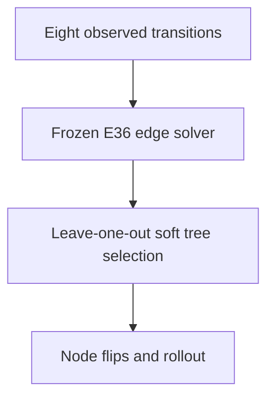

# Architecture

1,515 learned node parameters, 24 soft conditional trees with leave-one-out selection over eight transitions; frozen E36 edge solver.

## Data and model state

Conditioned and static tree checkpoints and the E36 edge-solver checkpoint set are included.

## Implementation

[original guide](research/TWM_INDUCT_STRUCTURAL_INDUCTION_2026-11-04/docs/README_REPRODUCTION_RU.md) · [archived results](research/TWM_INDUCT_STRUCTURAL_INDUCTION_2026-11-04/results/STAGE_SUMMARY.json) · [Model card](docs/MODEL_CARD.md)

`release.json` identifies the native directory and the exact commands executed by the launcher. The source tree contains the implementation, synthetic data or generators, historical protocols and experiment logs.
