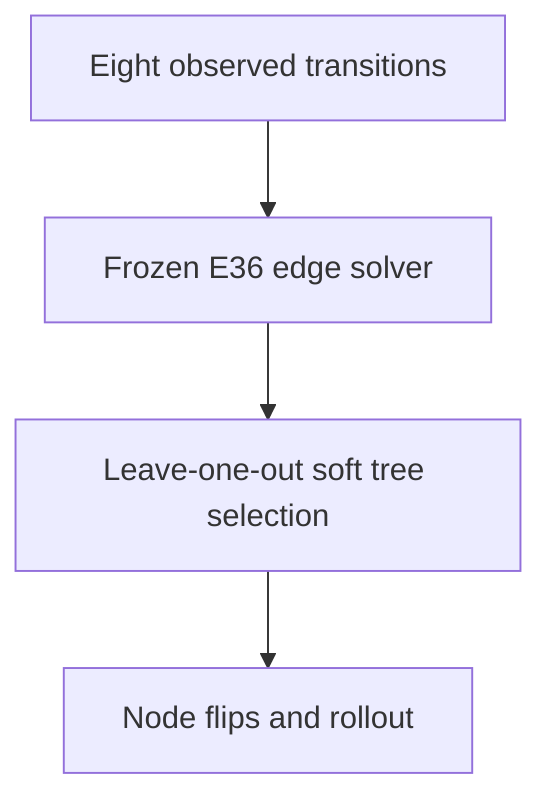

# INDUCT — Structural Induction Pilot

[Русский](README_RU.md) · [Model card](MODEL_CARD.md) · [Releases](https://github.com/skatzrskx55q/twm-induct-structural/releases/tag/v0.1.0-research)

> Research prerelease · 0.1.0-research · **Positive ablation; weaker than E36**

## Overview

1,515 learned node parameters, 24 soft conditional trees with leave-one-out selection over eight transitions; frozen E36 edge solver.

This release studies action-conditioned transitions in structured synthetic worlds. It predicts changes to the represented world state from the evidence specified by the native protocol. It can be used for controlled ablations and replication of transition or rollout experiments.

## Architecture



Full implementation and data flow are linked in [ARCHITECTURE.md](ARCHITECTURE.md).

## Historical benchmarks

Results come from the archived synthetic protocol. The [full benchmark record](BENCHMARKS.md) links the underlying artifacts.

| Experiment | Result | Reference |
|---|---:|---|
| Open dev L2 final H16 | 76/240 conditioned | 65/240 static · 84/240 E36 |
| Open dev L3 final H16 | 102/240 conditioned | 82/240 static · 108/240 E36 |

## Quick start

Linux x86-64 CPU, Python 3.13, and at least 1 GiB working space plus dependency space. [Installation and ZIP instructions](QUICKSTART.md).

```bash
git clone https://github.com/skatzrskx55q/twm-induct-structural.git
cd twm-induct-structural
python3.13 -m venv .venv
. .venv/bin/activate
python -m pip install torch==2.10.0 --index-url https://download.pytorch.org/whl/cpu
python -m pip install -r requirements.txt
python verify_integrity.py
python run.py check
python run.py --keep ../twm-induct-structural-demo demo
```

Recomputes synthetic graph rollouts for the conditioned, static, ablation, E36 and random variants.

## Training and reproduction

Train the conditioned and static node modules using the frozen E36 edge solver.

```bash
python run.py --keep ../twm-induct-structural-training native -- code/structural_experiment.py --steps 850 --seeds 17,29,43 --modes conditioned,static
```

[Original guide](research/TWM_INDUCT_STRUCTURAL_INDUCTION_2026-11-04/docs/README_REPRODUCTION_RU.md) · [Reproduction guide](docs/REPRODUCTION.md)

## Data and repository layout

Conditioned and static tree checkpoints and the E36 edge-solver checkpoint set are included.

Archived data, source, checkpoints and metrics are inside `research/`. The root launcher copies the native tree before execution. `research_manifest.json` lists original SHA-256 hashes and `validation/` contains archived and release-time checks.

## Validation and limitations

`check` **PASS** · `demo` **PASS**. Selected checks exercise the documented native entry points. [Logs and environment](validation/linux-cpu.md).

No sealed test labels in package; no superiority over E36.

## TWM Research Series

[twm-induct-e34](https://github.com/skatzrskx55q/twm-induct-e34) · [twm-induct-e36](https://github.com/skatzrskx55q/twm-induct-e36) · [Series index](SERIES.md)

## License and citation

TWM-owned material uses [MIT](LICENSE). [Licensing and attribution](LICENSE_NOTICE.md) records source notices. Cite the research release with [CITATION.cff](CITATION.cff) and identify the archived benchmark and seed used.
