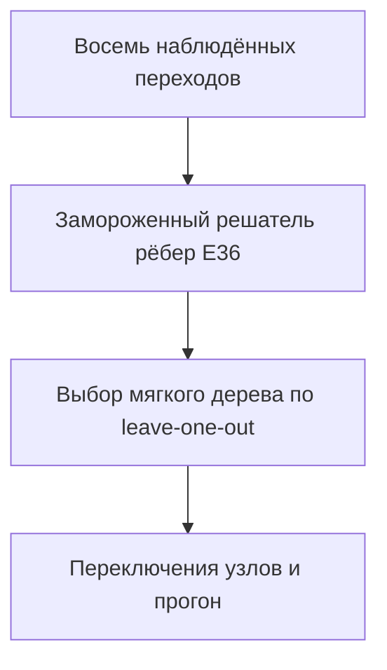

# INDUCT — Structural Induction Pilot

[English](README.md) · [Карточка модели](docs/MODEL_CARD_RU.md) · [Релиз](https://github.com/skatzrskx55q/twm-induct-structural/releases/tag/v0.1.0-research)

> Исследовательский предварительный релиз · 0.1.0-research · **Положительная абляция; слабее E36**

## Обзор

1 515 обучаемых параметров узлов, 24 мягких условных дерева с leave-one-out выбором по восьми переходам; замороженный рёберный E36.

В релизе исследуются переходы под действием команд в структурированных синтетических мирах. Модель предсказывает изменение состояния по наблюдениям, заданным исходным протоколом. Пакет предназначен для контролируемых абляций и повторения экспериментов с переходами или траекториями.

## Архитектура



Исходный код и схема работы описаны в [ARCHITECTURE.md](ARCHITECTURE.md).

## Исторические результаты

Показатели взяты из исторического синтетического эксперимента. [Описание результатов](BENCHMARKS.md) содержит ссылки на исходные материалы.

| Эксперимент | Результат | Контроль |
|---|---:|---|
| Открытый dev L2, конечное H16 | 76/240 conditioned | 65/240 static · 84/240 E36 |
| Открытый dev L3, конечное H16 | 102/240 conditioned | 82/240 static · 108/240 E36 |

## Быстрый старт

Linux x86-64 CPU, Python 3.13 и от 1 GiB рабочего места на диске плюс место для зависимостей. [Установка и запуск из ZIP](QUICKSTART.md).

```bash
git clone https://github.com/skatzrskx55q/twm-induct-structural.git
cd twm-induct-structural
python3.13 -m venv .venv
. .venv/bin/activate
python -m pip install torch==2.10.0 --index-url https://download.pytorch.org/whl/cpu
python -m pip install -r requirements.txt
python verify_integrity.py
python run.py check
python run.py --keep ../twm-induct-structural-demo demo
```

Пересчитывает траектории синтетических графов для условной и статической моделей, абляции, E36 и случайного контроля.

## Обучение и воспроизведение

Условный и статический узловые модули обучаются с замороженным решателем рёбер E36.

```bash
python run.py --keep ../twm-induct-structural-training native -- code/structural_experiment.py --steps 850 --seeds 17,29,43 --modes conditioned,static
```

[Исходное руководство](research/TWM_INDUCT_STRUCTURAL_INDUCTION_2026-11-04/docs/README_REPRODUCTION_RU.md) · [Инструкция по воспроизведению](docs/REPRODUCTION_RU.md)

## Данные и структура репозитория

Включены веса условной и статической моделей, а также набор весов решателя рёбер E36.

Исторические данные, код, веса и метрики лежат в `research/`. Перед запуском обёртка создаёт отдельную копию исходного дерева. В `research_manifest.json` записаны исходные SHA-256. В `validation/` хранятся архивные и новые проверки.

## Проверки и ограничения

`check` **PASS** · `demo` **PASS**. Выборочные проверки охватывают указанные исходные команды. [Журналы и окружение](validation/linux-cpu.md).

Закрытых test-меток в пакете нет; превосходства над E36 нет.

## TWM Research Series

[twm-induct-e34](https://github.com/skatzrskx55q/twm-induct-e34) · [twm-induct-e36](https://github.com/skatzrskx55q/twm-induct-e36) · [Каталог серии](SERIES.md)

## Лицензия и цитирование

Материалы TWM выпущены под [MIT](LICENSE). Исходное авторство указано в [лицензионных уведомлениях](LICENSE_NOTICE.md). Для цитирования релиза используйте [CITATION.cff](CITATION.cff) и указывайте исходный эксперимент и seed.
